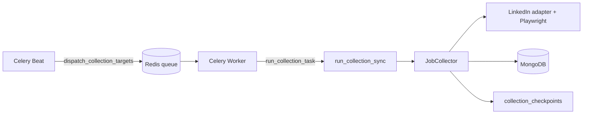

# Phase 2 — LinkedIn automatic collection (Celery Beat)

## Scheduling architecture



| Component | Role |
|-----------|------|
| **Beat** | Every `CELERY_BEAT_DISPATCH_INTERVAL_SECONDS` (default 120s), runs `dispatch_collection_targets`. |
| **Dispatcher** | Reads eligible `collection_targets` from worker DB; enqueues at most `CELERY_DISPATCH_MAX_PER_TICK` (default **1**) per tick. |
| **Worker** | `run_collection_task` → async collector with locks, checkpoints, deduped job upserts. |
| **worker-linkedin** | Optional Compose profile `celery-linkedin`: **Playwright image** (`Dockerfile.collector`), concurrency **1**, LinkedIn session volume. |
| **worker** | Slim image (`Dockerfile.worker`) — fixture / non-browser sources only. |

### Opt-in gates (all required for live LinkedIn scheduling)

1. `CELERY_ALLOW_LINKEDIN_TASKS=true`
2. `ALLOW_LIVE_LINKEDIN_COLLECTION=true`
3. Explicit **enabled** `collection_targets` rows (pilot config — not 2,000 manifest rows)
4. `CELERY_WORKER_MONGO_DB_NAME=global_jobs_test` (or prod only with `ALLOW_COLLECTION_PRODUCTION_DB=true`)

Offline scheduling test path (no live scrape):

- `CELERY_ALLOW_LINKEDIN_TASKS=true`
- `LINKEDIN_OFFLINE_HTML_ROOT=/path/to/fixtures`
- Live flag remains `false`

## Target management

- Canonical **40×50 manifest** remains in `config/global_jobs_40_countries_50_keywords_manifest.json` and `coverage_targets` — **not** auto-enabled for Celery.
- Pilot rows: `config/linkedin_pilot_targets.json` synced via:

  ```bash
  python -m app.cli.pilot_targets --mongo-db global_jobs_test
  ```

- Target identity: `(source, country_code, keyword, search_location)` when `ALLOW_COLLECTION_TARGET_INDEX_MIGRATION=true`.
- Tracker fields: `last_success_at`, `last_failure_at`, `last_run_at`, `last_error_summary`, `next_eligible_at`, locks.

## Database migration (targets + checkpoints)

| Index | Default API startup | With `ALLOW_COLLECTION_TARGET_INDEX_MIGRATION=true` |
|-------|---------------------|-----------------------------------------------------|
| `collection_checkpoints` | Migrates to 4-field unique (existing behaviour) | Same |
| `collection_targets` | Keeps legacy 3-field unique | Drops old `uniq_target_source_country_keyword`, backfills `search_location: ""`, creates 4-field unique |

**Production:** leave `ALLOW_COLLECTION_TARGET_INDEX_MIGRATION=false` until approved. Rollback: recreate 3-field unique after exporting distinct `(source, country_code, keyword)` conflicts (city-specific rows).

**Test DB:** set `ALLOW_COLLECTION_TARGET_INDEX_MIGRATION=true` before city-level pilot targets.

## Failure handling (LinkedIn)

Non-retryable access states (`verification_required`, `session_expired`, `authentication_required`, `access_denied`, `rate_limited`):

- Run marked **failed** in `collection_runs`
- Target `mark_failure` with `CELERY_LINKEDIN_ACCESS_PAUSE_SECONDS` (default 24h)
- Target **`enabled: false`** until operator re-enables

## Operations

```bash
# Fixture dispatcher smoke (worker profile celery)
python -m app.cli.celery_ops dispatch-once

# Worker health
python -m app.cli.celery_ops ping

# Pilot target sync (disabled by default in JSON)
python -m app.cli.pilot_targets --mongo-db global_jobs_test
```

### Enable limited live pilot (operator responsibility)

```yaml
# compose override — NOT committed enabled by default
CELERY_ALLOW_LINKEDIN_TASKS: "true"
ALLOW_LIVE_LINKEDIN_COLLECTION: "true"
ALLOW_COLLECTION_TARGET_INDEX_MIGRATION: "true"
```

Start: `docker compose --profile celery --profile celery-linkedin up -d worker-linkedin beat`

## Contabo deployment plan (do not execute yet)

1. **VM:** Ubuntu 22.04+, 8GB+ RAM recommended for Playwright worker.
2. **Compose stack:** `api`, `mongodb`, `redis`, `worker` (fixtures), `worker-linkedin`, `beat`, optional `nginx`.
3. **Volumes:** `linkedin_auth`, `mongodb_data`, `celerybeat_data`; encrypted backups of Mongo + session volume.
4. **Nginx:** TLS termination → `api:8000`; block public Celery/redis/mongo ports.
5. **Env secrets:** `.env` on host, `INTERNAL_OPS_TOKEN`, Mongo/redis passwords, **no** session JSON in git.
6. **Health:** `/health/live`, `/health/ready`, `celery_ops ping`, Uptime monitor on API.
7. **Backups:** `mongodump` cron + restore drill quarterly.
8. **Pilot gate:** single-country LinkedIn targets, `CELERY_DISPATCH_MAX_PER_TICK=1`, concurrency 1, 24h cooldown; expand only after stable runs.

**VPS readiness:** **Planning complete — not deployed.** Requires pilot runs, session ops runbook, and prod index approval before worldwide scheduling.