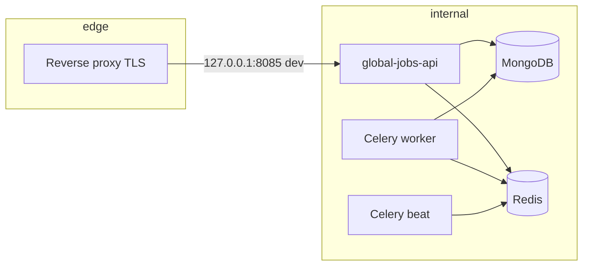

# Phase 3C — Production readiness

## Architecture (Docker Compose)

Public clients talk HTTPS to the proxy only. MongoDB and Redis stay on the internal network (no public ports).

## Risk register (evidence-based)

| ID | Severity | Risk | Mitigation / status |
|----|----------|------|---------------------|
| R1 | High | Regex `q` search without text index | Documented; escaped regex; 200-char cap; expect COLLSCAN at scale |
| R2 | High | Offset pagination deep `page` | `JOBS_MAX_PAGE=500`; cap `page_size` ≤ 100 |
| R3 | Medium | No Redis API rate limit | Headers + proxy rate limit on VPS; no new dependency |
| R4 | Medium | Legal redistribution of board data | Operator checklist; not a technical control |
| R5 | Medium | LinkedIn live scraping compliance | Disabled by default; not production-ready |
| R6 | Low | Test DB vs prod API split | `MONGO_DB_NAME`; collect redirects; docs 3B.2 |
| R7 | Low | 500 stack traces | Sanitized `internal_error` in `APP_ENV=production` |
| R8 | Low | SSRF via board HTTP client | HTTPS host allowlist |

## Security checklist

- [x] `.env` gitignored; example placeholders only
- [x] Internal ops 404 without `INTERNAL_OPS_TOKEN`; `compare_digest` on token
- [x] `ALLOW_COLLECTION_PRODUCTION_DB=false` in compose defaults
- [x] Public board live collection `false` by default
- [x] LinkedIn live + Celery LinkedIn `false`
- [x] API bound `127.0.0.1:8085` locally (not `0.0.0.0` on host)
- [x] Mongo/Redis not published in compose
- [x] API container runs as non-root (`appuser`)
- [x] Security headers + `Cache-Control: no-store` on `/api/*`
- [ ] Production: set `API_CORS_ORIGINS` explicitly
- [ ] Production: rotate all passwords from `.env.example` placeholders

## MongoDB performance notes

**Indexes (jobs):** unique `(source, sourceJobId)`; compounds on `(status, country_code|search_country_code, posted_at)`, source, employment, remote.

**Regex search:** title/company case-insensitive regex — suitable for modest corpora; Atlas Search / text index optional later.

**Pagination:** offset `skip/limit`; bounded by `JOBS_MAX_PAGE * page_size`.

**Explain:** `tests/mongodb/test_list_query_plans.py` (integration) verifies indexed plans for `country_code` + `active` lists.

## Collection reliability

- Source-scoped IDs: `{board_site}:{provider_id}`
- Upsert by `(source, sourceJobId)`
- Checkpoint `processed_ids` (can suppress re-fetch until cleared)
- Lock lease on targets; Celery fixture-only schedule
- Adapter HTTP: timeout, 10MB cap, 429 retryable with bounded collector retries

## Observability

| Signal | How |
|--------|-----|
| API live/ready | `GET /health/live`, `GET /health/ready` |
| Collection runs | Mongo `collection_runs`; CLI `collection_monitor` |
| Internal snapshot | `GET /internal/v1/monitoring/snapshot` (token) |
| Worker | `python -m app.cli.celery_ops ping` healthcheck |
| Logs | JSON in production (`configure_logging`) |

## Backup & restore (operator)

See `docs/CONTABO_DEPLOYMENT_PREFLIGHT.md` — **never** restore into `global_jobs` without dry-run and approval.

## Phase 3C code changes

- Safe 422/500 error bodies (no trace in production)
- `JOBS_MAX_PAGE` guard against deep offset abuse
- Production startup warnings for CORS / internal token
- Configurable Mongo server selection timeout

## Source permission checklist

- Public board API use ≠ unlimited republication rights
- Document employer attribution and apply URLs
- Obtain legal review before multi-tenant aggregation product
- Live collection remains operator-initiated CLI only